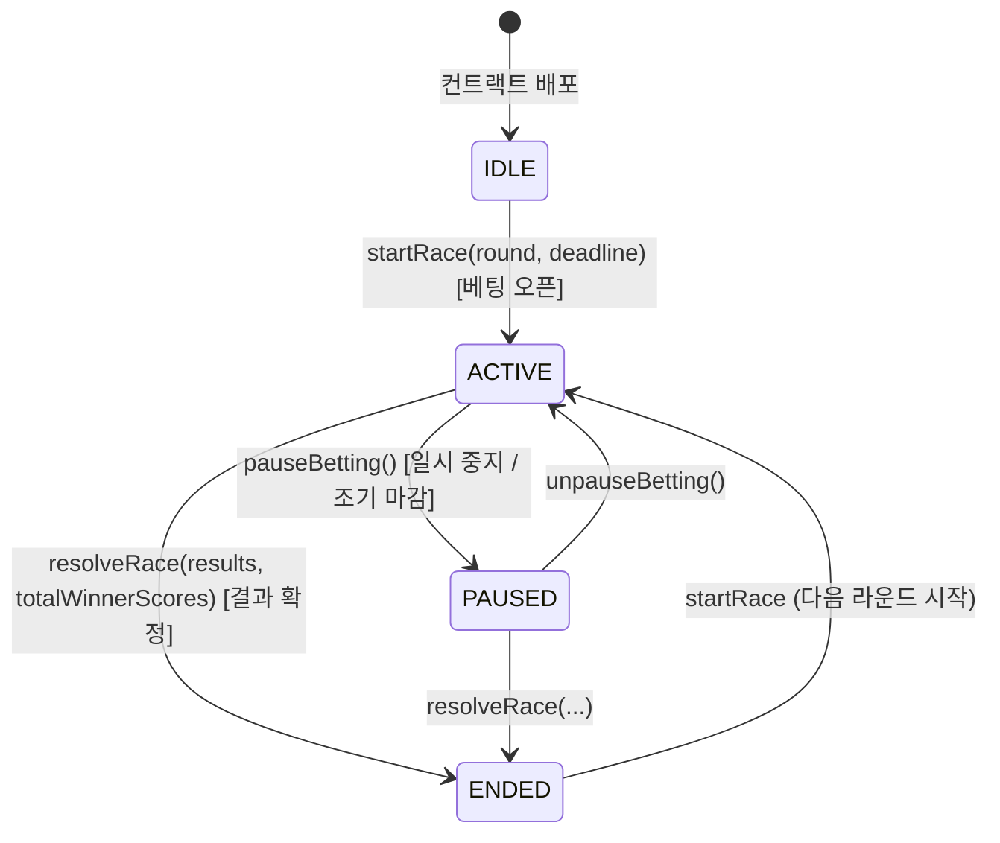

# 🏎️ F1 Podium Predictor

> **Ethereum Sepolia 기반 투명한 상금 풀 분배 및 F1 랩타임 데이터 분석 기반 온체인 예측 DApp**

---

### 1. 아이템, 문제인식 | 접근 방식 | 어떤 단계를 거치게 되었는지

* **기존 문제 인식**
  * 기존의 스포츠 예측/베팅 플랫폼은 **중앙화된 서버에서 자금 보관과 정산을 독점**하므로, 운영자의 조작 가능성, 정산 지연, 불투명한 수수료, 출금 거부 등 신뢰 문제가 끊임없이 발생했습니다.
  * 또한 사용자들은 경기 예측에 필수적인 F1 공식 랩타임, 서킷 특성, 드라이버별 최근 퍼포먼스 데이터를 플랫폼 외부에서 따로 찾아봐야 해 **데이터 기반의 합리적인 예측을 내리기 어려웠습니다.**

* **접근 방식**
  * **신뢰가 필요 없는(Trustless) 온체인 스마트 컨트랙트**: 참가비(0.01 Sepolia ETH) 예치, 타임락 기반 제출 마감, 상금 정산 및 분배를 블록체인 코드에 위임하여 완벽한 투명성을 확보했습니다.
  * **통합 레이스 데이터 오라클**: Ergast F1 API와 OpenF1 API를 연동하여 최근 연습 주행 랩타임, 팀 정보, 타 사용자들의 실시간 픽 비율을 단일 대시보드에서 제공했습니다.
  * **하이브리드 아키텍처(On-Chain + Off-Chain)**: 금전적 정산과 예측 원본은 블록체인에 영구 기록하되, 대량의 레이스 통계 조회와 고비용 연산은 백엔드 캐시 서버와 오라클이 보조하도록 설계하여 가스비를 최소화하고 사용자 경험을 극대화했습니다.

* **어떤 단계를 거치게 되었는지**
  1. **요구사항 정의 및 명세화 (v1.0 ~ v1.2)**: PRD, SRS, 화면 설계서 및 F1Betting 컨트랙트 인터페이스 정의
  2. **스마트 컨트랙트 개발 & 단위 테스트**: Hardhat 기반 로직 구현, 가스비 최적화, ReentrancyGuard 적용 및 Sepolia 배포
  3. **데이터 파이프라인 & 오라클 구축**: Node.js/Express, MySQL 기반 F1 API 캐싱 및 블록체인 이벤트 리스너(Oracle) 개발
  4. **웹 프론트엔드 연동**: React(Vite) + ethers.js v6 기반 MetaMask 지갑 연동, 실시간 타이머 및 트랜잭션 상태 UI 구현
  5. **아키텍처 고도화 & 핫픽스 (v1.3 ~ v1.16)**: 다중 경기(Multi-race) 지원, O(1) 가스비 분배 엔진 개편, 단일 신뢰 소스(Single Source of Truth) 원칙 기반 이벤트 파이프라인 정립

---

### 2. 기간

* **2026.05 ~ 2026.06**

---

### 3. 역할

* **1인 개발 (풀스택 & 스마트 컨트랙트)**
  * 스마트 컨트랙트 아키텍처 설계, 보안 감사 및 배포 (`F1Betting.sol`, Hardhat)
  * 백엔드 API 서버, 데이터베이스 모델링 및 온체인 이벤트 오라클 구축 (Node.js, Express, MySQL)
  * 반응형 웹 DApp UI/UX 디자인 및 Web3 연동 개발 (React, TypeScript, ethers.js v6, Vite)

---

### 4. 기여, 기술적 어려움을 어떻게 해결하였으며, 이때 본인의 기여도

* **온체인 가스비 한계(Block Gas Limit) 극복을 위한 하이브리드 정산 엔진 구축**
  * **문제**: 초기 설계에서는 경기 결과 확정 시 스마트 컨트랙트 내부에서 모든 참여자 배열을 루프 순회하며 점수를 계산하도록 구현되어, 참여자가 증가할 경우 $O(N)$ 복잡도로 인해 트랜잭션이 가스 한도 초과(`Out of Gas`)로 영구 중단될 위험이 있었습니다.
  * **해결**: 백엔드 DB에서 공식 결과와 유저 픽을 비교해 총 승자 점수(`totalWinnerScores`)를 선계산하고, 컨트랙트는 검증된 총점 분모만을 단 한 번 저장하도록 아키텍처를 전면 개편했습니다. 사용자가 본인의 몫을 온체인에서 직접 청구하는 **Pull-Payment 패턴**을 도입하여 결과 확정 및 인출 비용을 $O(1)$로 최적화했습니다.

* **이벤트 기반 단방향 파이프라인 확립을 통한 경쟁 상태(Race Condition) 원천 차단**
  * **문제**: 프론트엔드의 직접적인 REST API 호출과 백엔드 오라클의 온체인 이벤트 리스너 간 타이밍 불일치로 인해, 새로운 경기가 시작되었음에도 DB와 UI에 이전 경기 정보가 남거나 잘못된 경기가 활성화되는 데이터 불일치(Race Condition)가 발생했습니다.
  * **해결**: **신뢰의 단일 소스(Single Source of Truth)** 원칙을 도입했습니다. `프론트엔드(트랜잭션) ➔ 스마트 컨트랙트(이벤트 발행) ➔ 백엔드 오라클(이벤트 감지 및 DB 갱신)`의 엄격한 단방향 흐름으로 통일하고, `raceId` 기반의 명시적 상태 전이 안전장치를 구축하여 데이터 정합성을 100% 보장했습니다.

* **스마트 컨트랙트 보안 강화 및 엣지 케이스 방어**
  * `OpenZeppelin ReentrancyGuard`를 적용하여 상금 인출(`claimReward`) 과정의 재진입 공격(Reentrancy Attack)을 원천 차단했습니다.
  * 적중자가 아무도 없는 극단적 상황에서 상금 풀이 컨트랙트에 영구 잠식되는 문제를 방지하기 위해 비상 회수 함수(`recoverPool`)를 설계했습니다.
  * 경기 시작 전 타임락 검증 및 경기당 참여자 수 기반의 최대 점수 검증(`require(totalWinnerScores <= bettorsCount * maxScore)`)을 통해 관리자 키 유출 시 발생할 수 있는 오라클 조작 리스크를 컨트랙트 레벨에서 방어했습니다.

* **이종(Heterogeneous) F1 API 데이터 정규화 및 타임존 오차 해결**
  * Ergast API와 OpenF1 API 간의 드라이버 식별자(ID vs 영구 번호) 불일치 및 신규 드라이버 이미지 누락 현상을 해결하기 위해, 시즌 공식 로스터 기준의 단계별 폴백(Fallback) 캐싱 로직을 구현했습니다.
  * 클라이언트 브라우저 환경에 따라 경기 마감 시각이 잘못 파싱되거나 `NaN`이 발생하던 문제를 ISO 8601 UTC 포맷(`Z` 플래그) 강제 파싱 및 커스텀 타이머 훅으로 표준화했습니다.

---

### 5. 시스템 아키텍처 & 상태 머신

#### 🏗️ System Architecture
```
┌─────────────────────────────────┐        ┌──────────────────────────────────┐
│      Web Frontend (DApp)        │        │          Backend Server          │
│   (React + ethers.js v6 + Vite) │ <────> │       (Node.js + Express)        │
└────────────────┬────────────────┘        └────────────────┬─────────────────┘
                 │ RPC (JSON-RPC)                           │ REST / Oracle Polling
                 ▼                                          ▼
┌─────────────────────────────────┐        ┌──────────────────────────────────┐
│   Ethereum Sepolia Testnet      │        │       External Data & DB         │
│   (F1Betting.sol Contract)      │ ──Event──> (Ergast / OpenF1 API + MySQL)  │
└─────────────────────────────────┘        └──────────────────────────────────┘
```

#### 🔄 On-Chain State Machine


---

### 🛠 Tech Stack

| 영역 | 사용 기술 |
|:---|:---|
| **Smart Contract** | Solidity (v0.8.x), Hardhat, OpenZeppelin (ReentrancyGuard, Ownable) |
| **Network** | Ethereum Sepolia Testnet, Etherscan |
| **Frontend** | React, TypeScript, Vite, ethers.js v6, CSS Modules |
| **Backend** | Node.js, Express, Axios (API Caching & Oracle Engine) |
| **Database** | MySQL |
| **External API** | Ergast Developer API, OpenF1 API |
| **Tools & Wallet** | MetaMask, Git, GitHub |
